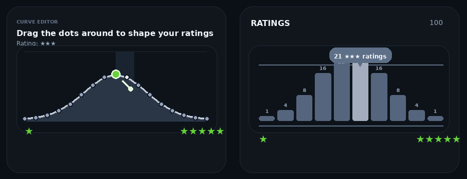

# Letterboxd Distribution Designer

Design a target Letterboxd rating curve, upload a Letterboxd CSV export, compare films head-to-head, and export updated ratings based on your comparison results.

The app combines two workflows:

- A curve designer for shaping the rating distribution you want
- A tier-by-tier comparison sorter for deciding which films belong in each rating band

Everything runs in the browser. Uploaded CSV data is parsed locally and session state is saved in local storage.

> This project is independently made and is not affiliated with Letterboxd.

## Features

- Drag curve control points to design a target ratings distribution
- Use normal, left-skewed, right-skewed, and bimodal presets
- Toggle whole-star or half-star rating bins
- Preview how the curve maps to rating quotas
- Upload Letterboxd `watched.csv`, `ratings.csv`, or `diary.csv`
- Optionally seed Glicko from imported ratings when the CSV includes ratings
- Pick preferred films in head-to-head comparisons
- Finalize rating tiers from five stars downward before moving to the next tier
- Identify the ordered top four using rating ± RD intervals, even when several favorites share a tier
- Settle films when their rating ± RD lies entirely within their tier
- Export a CSV with rank, assigned rating, Glicko, RD, tier probability, matches, wins, losses, imported rating, and Letterboxd URI

## Demo



## Run Without Installing

You can run the app directly from the downloaded project zip.

1. Click **Code** > **Download ZIP** on GitHub.
2. Unzip the download.
3. Open `letterboxd-distribution-designer.html` in your browser.

No Node.js install, terminal commands, or web server are required for normal use.

## Developer Setup

### Prerequisites

- Node.js 18+
- npm

### Install

```bash
npm install
```

### Run Locally

```bash
npm run dev
```

Then open the local URL printed in your terminal.

### Build

```bash
npm run build
```

### Build The Clickable HTML

```bash
npm run build:standalone
```

This regenerates `letterboxd-distribution-designer.html` from the production Vite bundle. Run it after source changes that should be included in the downloadable zip experience.

### Preview Production Build

```bash
npm run preview
```

## How To Use

1. Shape the target ratings curve with the preset buttons and draggable curve points.
2. Keep half-star ratings enabled for the classic 0.5 to 5.0 Letterboxd scale, or disable them for whole-star ratings.
3. Upload a Letterboxd CSV export.
4. Choose the film you prefer in each head-to-head pair. You can also use the left and right arrow keys.
5. Follow the current tier until all its films have settled rating ± RD intervals, then move down the scale. Zero-quota tiers are skipped.
6. Once the tiers are finalized, finish any comparisons needed to order your top four.
7. Export the updated ratings CSV, including per-film tier probabilities, top-four positions, and overall estimated tier accuracy.

## Supported CSV Columns

The importer looks for common Letterboxd-style columns. It is intentionally flexible about column names.

- Title: `Name`, `Title`, `Film`, or `Movie`
- Year: `Year` or `Release Year`
- Link: `Letterboxd URI`, `URI`, `URL`, or `Link`
- Watched date: `Watched Date` or `Date`
- Rating: `Rating`, `Stars`, or `Score`

Rows without a recognizable title are skipped. Duplicate films are deduped by URI when available, otherwise by title and year.

## How Ratings Are Assigned

The curve is sampled into rating-bin probabilities. Those probabilities become quotas for the current film count using largest-remainder rounding, so the assigned counts still add up to the number of imported films.

Films are ordered by their Glicko rating and assigned to the target quotas. The implementation uses [Glicko-1 as described by Mark Glickman](https://www.glicko.net/glicko/glicko.pdf), with each comparison treated as one rating period. Both films update from their pre-comparison rating and rating deviation (RD), without rounding stored values. RD is floored at 30; calendar-time inflation is disabled (`c = 0`) for this static film-ranking workflow.

Unseeded films begin at rating 1500 with RD 350. When imported-rating seeding is enabled, the initial rating is `1500 + (imported stars - 3) * 115`, with RD 150. This narrower seeded RD is an application prior reflecting the imported preferences, not a universal Glicko default.

### Settling tiers and the top four

A tier cutoff is the midpoint of the Glicko ratings immediately above and below its quota boundary. Empty tiers are skipped; the highest and lowest tiers extend to positive and negative infinity respectively. A film is settled when its **rating minus RD and rating plus RD both lie strictly inside its assigned tier**. Touching a cutoff remains unsettled, including tied ratings. The app finalizes a tier when all its assigned films meet that rule, then moves downward. Tier progress is the percentage of assigned films whose intervals are settled.

Pair selection focuses on unsettled films in the highest unfinished tier and plausible challengers across the relevant cutoff. Each side contributes up to 12 candidates based on distance to the cutoff relative to RD; at most 144 pairs are scored. This includes uncertain challengers without requiring favorites to beat every distant low-rated film.

After tiers settle, the ordered top four uses the same interval rule within each individual rank's midpoint boundaries, including the fourth/fifth cutoff. For fewer than four films, all available positions are considered. These are interval-settlement criteria, not 90% probability thresholds. Earlier tiers can reopen after new answers, undo, or a curve edit. Skips change pair preference without updating ratings or RD.

### What the confidence percentage means

The separate estimated tier-accuracy display retains the original interpretation: the estimated probability that a uniformly selected film is in its correct tier. For a film with rating `r`, RD `d`, and current tier boundaries `L` and `U`, its tier probability is `Phi((U-r)/d) - Phi((L-r)/d)`, where `Phi` is the standard normal CDF. Overall accuracy averages these probabilities. This is a normal approximation conditional on the current point-estimated cutoffs; it does not include uncertainty in the cutoffs themselves and is not an empirically calibrated guarantee.

RD is one standard deviation, so containment of rating ± RD is deliberately separate from the former 90% threshold. The interface and CSV distinguish model probabilities from interval-settlement progress.

### Saved sessions and performance

Older saved sessions migrate automatically by replaying their comparison history from the selected imported-rating priors using Glicko. Undo snapshots are rebuilt with both rating and RD. New sessions save under a versioned Glicko key; the older saved data is retained. Migration may change the order because the rating algorithm has changed.

Ranking no longer runs Monte Carlo simulations. The film order is memoized, tier analysis scans the list, candidate pair scoring is bounded, and results render 100 films per page while CSV export still includes every film. Curve sampling sorts control points once per batch. Saving is debounced by 250 ms and flushed when leaving the page, avoiding full-history serialization on every curve movement.

A local Node benchmark on a synthetic 2,000-film library measured median ranking computation at about 486 ms for the preceding simulation implementation and 1 ms for this implementation. This measures computation, not end-to-end browser frame rate. Run `npm run benchmark` to measure the current implementation on the same synthetic library.

### Validation

```bash
npm test
```

Tests verify the published Glicko numerical example, simultaneous participant updates, RD-aware undo and saved-session migration, strict interval containment, analytic probabilities, descending tier priority, distant-challenger avoidance, top-four settlement, bounded pair selection, and rendered results pagination.

## Data And Persistence

- CSV parsing happens in the browser.
- Imported films, curve settings, and match history are saved in local storage.
- Use the app's clear/reset controls, or clear site data in your browser, to remove saved state.
- Exported results are downloaded as `letterboxd-updated-ratings.csv`.

## Project Structure

```txt
letterboxd-distribution-designer/
|-- public/
|   |-- demo.gif
|   `-- favicon.svg
|-- scripts/
|   `-- build-standalone.mjs
|-- src/
|   |-- App.jsx
|   |-- index.css
|   `-- main.jsx
|-- index.html
|-- letterboxd-distribution-designer.html
|-- package.json
|-- postcss.config.js
|-- README.md
|-- tailwind.config.js
`-- vite.config.js
```

`src/glicko.js` implements rating updates and saved-session migration. `src/ranking.js` contains interval settlement, analytic tier probabilities, and pair selection. `tests/ranking.test.mjs` validates the ranking behavior.

## License

MIT License. See `LICENSE` for details.
